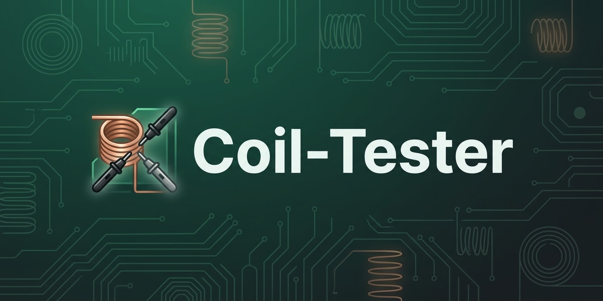
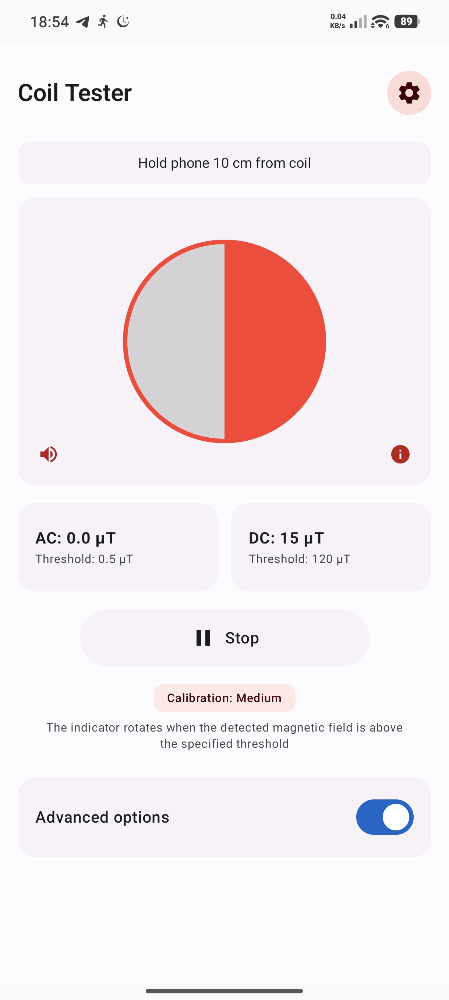
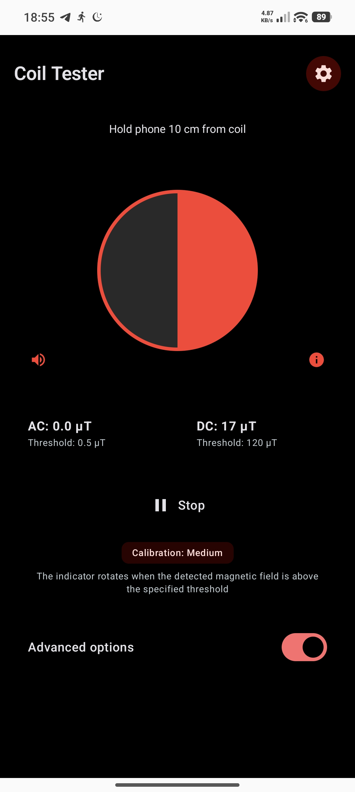

# CoilTester

<a id="readme-top"></a>

[](https://github.com/Hcmdz/Coil-Tester/releases/latest)

<div align="center">
   <a href="https://github.com/Hcmdz/Coil-Tester/releases">
      
   </a>
   <a href="https://apps.obtainium.imranr.dev/redirect?r=obtainium://add/https://github.com/Hcmdz/Coil-Tester/">
      
   </a>
</div>

<br />

[](https://www.android.com)
[](https://kotlinlang.org)
[](#)
[](#)
[](https://www.gnu.org/licenses/gpl-3.0)
[](https://github.com/Hcmdz/Coil-Tester/releases/latest)
[](https://github.com/Hcmdz/Coil-Tester/releases)
[](https://github.com/Hcmdz/Coil-Tester/stargazers)
[](https://developer.android.com/jetpack/compose)

Coil detection, made measurable. CoilTester turns your phone's magnetometer into a calibrated coil-testing instrument: it reads AC and DC magnetic fields in real time, flags detected coils with haptic and audio feedback, and guides you to the right distance — all offline, with no account and no tracking.

<p align="center">
  <a href="#-screenshots">View Screenshots</a>
  ·
  <a href="https://github.com/Hcmdz/Coil-Tester/issues/new?labels=bug">Report Bug</a>
  ·
  <a href="https://github.com/Hcmdz/Coil-Tester/issues/new?labels=enhancement">Request Feature</a>
</p>

- **Package**: `org.coiltester.app`
- **Version**: 1.0.0 (versionCode 1)

---

## 📦 Downloads

[](https://github.com/Hcmdz/Coil-Tester/releases/latest)

GitHub sideloading: **[Latest release](https://github.com/Hcmdz/Coil-Tester/releases/latest)** (`CoilTester-release.v1.0.0.apk`, ~2.7 MB, universal).

- Requires Android 7.0+ (API 24).
- Verify integrity: `sha256sum -c CoilTester-release.apk.sha256` (sidecar next to the APK).
- ⚠️ If a release ever changes signing key, document it here: back up, uninstall, install, restore (Android refuses updates across certificates).

---

## 📸 Screenshots

### Detection (main screen)

Real-time AC/DC magnetic field detection with status, distance guide, and controls.

<div align="center">

| Light Mode | Dark Mode |
|---|---|
| <a href="screenshots/detection-light.jpg"></a> | <a href="screenshots/detection-dark.jpg"></a> |

</div>

---

## ✨ Key Features

### Detection
- **Real-time AC/DC magnetic field detection** via the device magnetometer, with configurable sensitivity (Low / Medium / High).
- **Haptic and audio feedback** at detection, with adjustable volume and a calibration-complete cue.
- **Distance guide** showing a 10 cm target to help position the sensor over the coil.

### Calibration
- **Sensor calibration** with stored offset/scale data and a reset option.
- **Advanced options** for custom AC/DC thresholds and mains frequency band (50 / 60 Hz).

### Settings & UX
- **Trilingual UI** — French (default), English, Arabic with full RTL support.
- **Theme** — Light, Dark, Pure Black (AMOLED), or follow system.
- **Fullscreen** — immersive display with transparent status/navigation bars.

### Privacy
- **100% offline** — no `INTERNET` permission, no accounts, no tracking, no analytics.
- **No backup** of the Room database or DataStore preferences (`allowBackup="false"`).

---

## 🛠️ Tech Stack & Architecture

### Architecture

Multi-module project (`:app`, `:core`, `:data`, `:build-logic:convention`) with Clean Architecture + MVI:

- **Domain** (`core`) — pure Kotlin, no Android dependencies, testable on JVM.
- **Data** (`data`) — Room (single source of truth) + DataStore (Preferences) for settings.
- **UI** (`app`) — Jetpack Compose + Material 3, adaptive layouts, MVI ViewModels with `StateFlow`.
- Typed errors via `Result<T, E>` everywhere; cancellation never swallowed.

### Core Libraries & Tools

Exact versions from `gradle/libs.versions.toml`:

| Category | Library | Version |
|---|---|---|
| **Build** | Android Gradle Plugin | 8.7.3 |
| **Build** | Kotlin | 2.1.0 |
| **Build** | KSP | 2.1.0-1.0.29 |
| **Build** | Gradle | 8.13 |
| **UI** | Jetpack Compose (BOM) | 2024.12.01 |
| **UI** | Material 3 | 1.3.1 (via BOM) |
| **UI** | Activity Compose | 1.9.3 |
| **UI** | Lifecycle / ViewModel | 2.8.7 |
| **UI** | Navigation Compose | 2.8.5 |
| **DI** | Koin | 4.0.0 |
| **Database** | Room | 2.6.1 |
| **Persistence** | DataStore (Preferences) | 1.1.1 |
| **Async** | Kotlin Coroutines & Flow | 1.9.0 |
| **Serialization** | kotlinx-serialization | 1.7.3 |

### Security Features

| Control | Implementation |
|---|---|
| Network security | Cleartext disabled (`android:usesCleartextTraffic="false"`, NSC), no `INTERNET` permission |
| Backup disabled | `allowBackup="false"`, `data_extraction_rules.xml` / `backup_rules.xml` exclude Room DB and DataStore |
| Minification | R8 full mode on release builds (`isMinifyEnabled = true`, `isShrinkResources = true`) |
| Code quality | Detekt 1.23.7 + Ktlint 12.2.0 in CI |
| Licensing | Licensee plugin gates dependencies (Apache-2.0 only) |

### Permissions

- `VIBRATE` — haptic feedback on detection.
- `WAKE_LOCK` — keep the screen awake during detection sessions.
- `BODY_SENSORS` — magnetometer access (API 29+).
- `HIGH_SAMPLING_RATE_SENSORS` — high-rate magnetometer sampling (API 31+).
- `FOREGROUND_SERVICE` / `FOREGROUND_SERVICE_SENSOR` — foreground sensor service.

Hardware features required: compass sensor, vibrator.

Entry points: `CoilTesterApplication` (Application), `MainActivity` (launcher).

### CI & Quality

- GitHub Actions: `.github/workflows/ci.yml` (`test` + `lint` + `detekt` + `ktlintCheck` + `assembleDebug`), `.github/workflows/release.yml` (on `v*` tag: signed AAB + GitHub Release), `.github/workflows/secret-scan.yml`.
- Detekt: `./gradlew detekt` (config `config/detekt/detekt.yml`, baseline `app/detekt-baseline.xml`).
- Ktlint: `./gradlew ktlintCheck` / `ktlintFormat` (plugin applied to `:app`).
- CI/Deployment inventory: `KEYSTORE_FILE`, `KEYSTORE_PASSWORD`, `KEY_ALIAS`, `KEY_PASSWORD` (GitHub Secrets).

---

## 🚀 Getting Started

### Prerequisites

- **Android Studio**: latest stable — IDE ([doc](https://developer.android.com/studio))
- **JDK**: 17 — Gradle toolchain ([doc](https://docs.gradle.org/current/userguide/build_java_projects.html))
- **Minimum Android API Level**: 24 (Android 7.0)

### Installation

1. **Clone the repository**:
   ```bash
   git clone https://github.com/Hcmdz/Coil-Tester.git
   cd Coil-Tester
   ```

2. **Build the project**:
   ```bash
   ./gradlew build
   ```

### Run the App

1. Open the project in **Android Studio**.
2. Wait for Gradle sync to complete.
3. Select a device or emulator running **API 24+**.
4. Press **Run** (Shift + F10) or run `./gradlew installDebug` from the terminal.

---

## 🧪 Testing

Run the full test suite (unit + instrumented):

```bash
./gradlew test
./gradlew connectedAndroidTest
```

Unit tests (JVM, KMP domain + data): `./gradlew :core:test :data:test :app:test`
Detekt: `./gradlew detekt`
Ktlint: `./gradlew ktlintCheck`
JaCoCo report: `./gradlew :app:jacocoTestReport`

---

## 📁 Project Structure

```
CoilTester/
├── app/                          # Android app (Compose UI, ViewModels, DI)
│   ├── src/main/kotlin/.../app/
│   │   ├── MainActivity.kt       # Entry point (locale, edge-to-edge)
│   │   ├── CoilTesterApplication.kt
│   │   ├── ui/                   # Compose screens (detection, settings, theme)
│   │   ├── viewmodel/            # MVI ViewModels (StateFlow + sealed Intent)
│   │   ├── platform/             # SensorProvider, HapticService, SoundService, PermissionHelper
│   │   └── di/                   # Koin modules
│   └── src/main/res/             # Resources (values, values-en, values-ar)
├── core/                         # Pure Kotlin (KMP): models, repositories, use cases, DetectionEngine
├── data/                         # Room entities/DAOs, DataStore prefs, repository impls
├── build-logic/convention/       # Gradle convention plugins
├── config/detekt/                # Detekt configuration
└── .github/workflows/            # CI/CD (ci.yml, release.yml, secret-scan.yml)
```

---

## 🔏 Signing

How to build a signed release APK. The keystore stays **outside** the repository, in `~/.gradle/gradle.properties`, and its values are never committed. Put these four properties there, one `name=value` pair per line:

- `RELEASE_STORE_FILE` - path to your keystore
- `RELEASE_STORE_PASSWORD` - the keystore password
- `RELEASE_KEY_ALIAS` - the key alias
- `RELEASE_KEY_PASSWORD` - the key password

Without them the build still succeeds and ships an unsigned release.

```bash
./gradlew assembleRelease
```

---

## 📏 APK Size

Current release APK size: measured in CI (see GitHub Releases for the published artifact, R8 full mode enabled with resource shrinking).

---

## 📝 Changelog

### v1.0.0
- Initial release: AC/DC coil detection, calibration, distance guide, trilingual UI (FR/EN/AR), Material 3 theming.
- Build: AGP 8.7.3, Kotlin 2.1.0, Compose BOM 2024.12.01, SDK 35.

Full history in [GitHub Releases](https://github.com/Hcmdz/Coil-Tester/releases).

---

## ⚖️ Legal

- [Privacy Policy](docs/privacy/) — required before Play publishing
- [Terms of Service](docs/terms/) — required before Play publishing

---

## 📄 License

This project is licensed under the [GPL-3.0](LICENSE) — see the [LICENSE](LICENSE) file for details.

### Trademark Notice

The application name "CoilTester", along with all original branding artwork, logos, and custom launcher icons, are the exclusive intellectual property and trademarks of the author. Redistribution or modification of the source code under the GPL-3.0 does not grant permission to use these brand assets in derivative works. All forks must be entirely rebranded.

---

## 🗺️ Roadmap

- [x] Dependency upgrade to AGP 8.7 / Kotlin 2.1 / Compose BOM 2024.12
- [x] Detekt + Ktlint quality gates activated
- [x] JaCoCo coverage reporting
- [ ] Compose UI tests (Robot pattern)
- [ ] Refactor long composables (DetectionScreen, MagneticToolScreen)
- [ ] F-Droid / Play Store publication

See the [open issues](https://github.com/Hcmdz/Coil-Tester/issues) for proposed features and known issues.

---

## 🔗 Related Docs

- [Contributing](CONTRIBUTING.md) · [Third-Party Components](THIRD_PARTY.md) · [Security](SECURITY.md)

---

## 🙏 Acknowledgments

- [Jetpack Compose](https://developer.android.com/jetpack/compose) — modern Android UI toolkit
- [Koin](https://insert-koin.io/) — lightweight dependency injection
- [Room](https://developer.android.com/training/data-storage/room) — SQLite abstraction

<p align="right">(<a href="#readme-top">back to top</a>)</p>
